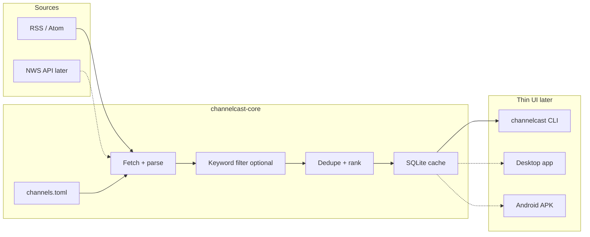

# ChannelCast

On-demand multi-channel news app (PointCast-inspired). **Rust core** first; Windows desktop UI next, then Linux/Mac, then an Android APK via a thin shell around the same core.

**Shipping name:** ChannelCast (not PointCast — that 1990s name was later co-opted).

## What it is

- An app **you open when you want news**
- Topic **channels** (Top, Tech, Markets, Sports, …) backed by free public RSS/Atom feeds
- A shared **`channelcast-core`** library: config → fetch → optional keyword filter → dedupe by URL → rank by recency → optional SQLite cache
- A CLI (`channelcast`) so the core is usable before any GUI ships

## What it is not

- **Not** the 1990s PointCast Network screensaver / SmartScreen push client
- **Not** [The Morning Newspaper](https://x.ai/bot/1xAJYJPes3X7dUM2mk9Di) (that bot turns *your* email + calendar into a personal paper)
- **Not** ad-sponsored push media
- **Not** LLM “prophecy” generation — the optional `watchman` channel only aggregates allowlisted news RSS and filters by editable keywords
- **No Grok Bot required** — the app is standalone
- Listing an outlet in `channels.toml` is **not an endorsement** of its views

## Architecture



## Quick start

```bash
# from repo root
cargo run -p channelcast-cli -- channels
cargo run -p channelcast-cli -- channels --all   # include disabled personal channels
cargo run -p channelcast-cli -- headlines tech
cargo run -p channelcast-cli -- headlines top -n 10
cargo run -p channelcast-cli -- headlines prowrestling
cargo run -p channelcast-cli -- headlines watchman   # works even when disabled in listing
cargo run -p channelcast-cli -- fetch markets
```

Binary name: **`channelcast`**.

Optional flags:

- `--config path/to/channels.toml` — override feed list
- `--cache path.db` — SQLite cache (default `.channelcast/cache.db`)
- `--no-cache` — skip disk cache

## Default channels (v0.1)

| id | status | feeds (HTTP 200 verified 2026-10-24) |
|----|--------|--------------------------------------|
| `top` | on | BBC World, NPR News |
| `tech` | on | Hacker News (hnrss), Ars Technica |
| `markets` | on | BBC Business, CNBC Top News |
| `sports` | on | BBC Sport, ESPN Top |
| `prowrestling` | on, personal | Fightful, F4W Online |
| `watchman` | **disabled by default**, personal | Jerusalem Post frontpage, Times of Israel, BBC Middle East + keyword filter |
| `weather` | stub | needs lat/lon → [NWS API](https://www.weather.gov/documentation/services-web-api) |
| `local` | stub | needs city / ZIP |

### Feed verification notes

**Committed (200 + RSS/Atom):** Fightful, F4W Online, JPost frontpage RSS, Times of Israel, BBC Middle East, plus the general channels above.

**Tried and dropped:**

| URL / site | Result |
|------------|--------|
| PWInsider RSS paths | 404 |
| israel365news / breakingisraelnews (`israel365news.com`) | Cloudflare challenge (403) from box/CLI — wanted for watchman; feed URL noted as pending in `channels.toml` |
| ProphecyNewsWatch feed URLs | 404 |
| watch.org/feed | 404 |
| Haaretz cmlink | 200 but HTML, not RSS |
| CNN Middle East RSS | failed to connect from this environment |

**Needs RSS or licensed API (not scraped in v0.1):** israel365news, other “watchman-style” prophecy portals without a public feed. Add URLs to `channels.toml` when they expose RSS.

Edit `channels.toml` to add feeds, flip `enabled`, or change `watchman.keywords` (Turkey, Gog/Magog, Damascus, temple, red heifer, Ezekiel, … — editable config, not hardcoded theology).

## Development

```bash
cargo test
cargo run -p channelcast-cli -- headlines tech
```

Fixture-based tests (RSS + Atom parse, cache round-trip, keyword filter) do not need the network. Live `headlines` / `fetch` do.

## Roadmap

1. **Now** — Rust core + CLI (this repo)
2. **Desktop UI** — Windows first (egui/iced or similar), then Linux/Mac
3. **Weather** — NWS API once location is set
4. **Local** — regional RSS keyed off city/ZIP
5. **Android APK** — thin shell + `channelcast-core` via UniFFI/JNI
6. Optional companion bot later for digests — not required for the app

## License

MIT — see [LICENSE](LICENSE).
